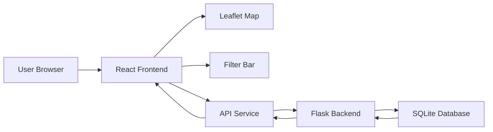

# Requirements

### Overview & Goals
Build a web application that displays an interactive map of London showing locations where films, songs, and other cultural elements were created or filmed. Users can explore London's cultural heritage by browsing mapped locations filtered by category (films, music, literature, etc.).

### User Stories
- As a user, I want to see an interactive map of London so I can explore cultural locations visually.
- As a user, I want to filter locations by category (films, music, literature) so I can find what interests me.
- As a user, I want to click on a marker and see details about the location (name, description, media, category).
- As a developer, I want a clean data model so I can easily add new cultural locations.

### Scope
**In Scope:**
- Interactive map with markers for cultural locations in London
- Category filtering (films, music, literature, TV shows, etc.)
- Info panels/popup cards with location details
- A curated dataset of London cultural locations
- Responsive web design

**Out of Scope:**
- User authentication or accounts
- User-generated content or reviews
- Real-time data feeds
- Mobile native apps

# Technical Design

### Recommended Tech Stack

**Frontend:**
- **React** (with Vite) — fast, well-documented, large ecosystem
- **Leaflet** — lightweight, open-source map library (simpler than Mapbox/Google Maps; no API key required)
- **OpenStreetMap** — free tile provider for Leaflet (no API key needed)
- **CSS** (or Tailwind CSS if preferred) — styling

**Backend:**
- **Python** (already have `.venv`) with **Flask** — lightweight, easy to set up, great for APIs
- **SQLite** — simple file-based database, no server needed; easy to migrate to PostgreSQL later

**Data:**
- Curated JSON or database entries with location name, description, category, coordinates (lat/lng), and optional media links

### Project Structure

```
FirstYearHack/
├── backend/
│   ├── app.py                  # Flask app entry point
│   ├── routes/
│   │   ├── __init__.py
│   │   └── locations.py        # API endpoints for locations
│   ├── models/
│   │   ├── __init__.py
│   │   └── location.py         # Location data model
│   ├── database.py             # Database setup and connection
│   ├── seed_data.py            # Script to populate initial data
│   ├── requirements.txt
│   └── static/                 # (optional) served assets
├── frontend/
│   ├── src/
│   │   ├── main.jsx
│   │   ├── App.jsx
│   │   ├── components/
│   │   │   ├── MapView.jsx          # Leaflet map component
│   │   │   ├── LocationMarker.jsx   # Custom marker component
│   │   │   ├── InfoPanel.jsx        # Popup/detail panel
│   │   │   ├── FilterBar.jsx        # Category filter UI
│   │   │   └── Header.jsx           # App header/navigation
│   │   ├── services/
│   │   │   └── api.js               # API calls to backend
│   │   └── styles/
│   │       └── main.css
│   ├── index.html
│   ├── package.json
│   └── vite.config.js
├── data/
│   └── locations.json          # Initial dataset (curated locations)
├── README.md
└── .gitignore
```

### Key API Endpoints
- `GET /api/locations` — return all locations (supports `?category=film` filter)
- `GET /api/locations/:id` — return a single location by ID
- `GET /api/categories` — return available categories

### Data Model
```python
Location {
    id: int
    name: str
    description: str
    category: str          # "film", "music", "literature", "tv", "theatre"
    latitude: float
    longitude: float
    address: str
    media_url: str         # optional: link to photo, trailer, or song
    year: int              # optional: year of release/filming
}
```

### Architecture Diagram



### Why This Stack
- **No API keys needed** — OpenStreetMap + Leaflet are fully open source, which is ideal for a hackathon
- **Python + Flask** — you already have a `.venv`, so the environment is ready
- **SQLite** — zero configuration, file-based, perfect for prototyping
- **React + Vite** — fast setup, hot reload, widely used

# Team Division

### Recommended Work Split for 3 People

The work is divided so each person owns a relatively independent area, minimizing merge conflicts while still integrating into a cohesive app.

#### Person 1: Backend + Data
**Responsibilities:**
- Set up Flask project structure (`backend/`)
- Create the Location data model and SQLite database
- Build API endpoints (`GET /api/locations`, `GET /api/locations/:id`, `GET /api/categories`)
- Research and curate the initial dataset of London cultural locations (30-50 entries)
- Write the `seed_data.py` script to populate the database
- Configure CORS so the frontend can call the API

**Deliverables:**
- Working REST API with location data
- Seeded database with curated London locations
- API documentation in README

#### Person 2: Map + Markers (Frontend Core)
**Responsibilities:**
- Set up React + Vite project (`frontend/`)
- Integrate Leaflet map with OpenStreetMap tiles
- Build `MapView.jsx` component centered on London
- Build `LocationMarker.jsx` with custom icons per category
- Fetch and render markers from the backend API
- Implement click-to-show popup with location details

**Deliverables:**
- Interactive map displaying all location markers
- Category-specific marker icons
- Clickable markers with detail popups

#### Person 3: UI + Filtering (Frontend Polish)
**Responsibilities:**
- Build `FilterBar.jsx` with category toggle buttons
- Implement filtering logic (filter markers by selected category)
- Build `InfoPanel.jsx` as a side panel or modal for detailed location info
- Build `Header.jsx` with app title and branding
- Style the entire app (responsive design, colors, typography)
- Ensure the app looks polished and is mobile-friendly

**Deliverables:**
- Category filtering UI connected to map
- Detail panel for location information
- Polished, responsive UI

### Collaboration Strategy
- **Shared contracts:** Agree on the API response format early so Person 2 and 3 can mock data while Person 1 builds the backend
- **Git branching:** Each person works on their own branch (`backend-api`, `map-core`, `ui-filtering`) and merges into `main` regularly
- **Integration meetings:** Schedule short syncs to connect the pieces (e.g., Person 2 connects to Person 1's API, Person 3 connects filters to Person 2's map)

# Helpful Packages

### Frontend Packages
| Package | Purpose |
|---|---|
| `react`, `react-dom` | Core React library |
| `leaflet` | Open-source interactive maps |
| `react-leaflet` | React bindings for Leaflet |
| `@vitejs/plugin-react` | Vite plugin for React |
| `axios` or `fetch` | HTTP client for API calls |

### Backend Packages
| Package | Purpose |
|---|---|
| `flask` | Lightweight web framework |
| `flask-cors` | Enable cross-origin requests from frontend |
| `flask-sqlalchemy` | ORM for database models |
| `sqlite3` | Built-in SQLite support |

### Optional Enhancements
| Package | Purpose |
|---|---|
| `tailwindcss` | Utility-first CSS framework (if preferred over plain CSS) |
| `leaflet-markercluster` | Cluster nearby markers for better performance |
| `geopy` | Geocoding addresses to coordinates (for data preparation) |

### Suggested London Cultural Data Sources
- **London Film Locations** — well-documented filming locations
- **BBC London Music** — music venues and recording locations
- **Literary London** — book-related walking tours and locations
- **West End Theatre** — theatre venues and historic locations
- **Wikipedia** — lists of films shot in London, music venues, etc.

# Delivery Steps

### ✓ Step 1: Set up project scaffolding and shared contracts
Initialize the repository structure so all three team members can start working in parallel.
- Create the `backend/`, `frontend/`, and `data/` directories with their starter files
- Define the shared API contract (request/response format for locations and categories)
- Create a `.gitignore` and `README.md` with setup instructions
- Set up initial Git branches for each team member

### ✓ Step 2: Build backend API with location data
Person 1 delivers a working REST API with a seeded database of London cultural locations.
- Set up Flask app with SQLite database and Location model
- Implement `GET /api/locations` with category filtering support
- Implement `GET /api/locations/:id` for individual location details
- Implement `GET /api/categories` for available categories
- Curate and seed 37 London cultural locations into the database
- Configure CORS for frontend access

### ✓ Step 3: Build interactive map with markers
Person 2 delivers an interactive Leaflet map centered on London with category-specific markers.
- Set up React + Vite project with Leaflet integration
- Build `MapView.jsx` component with OpenStreetMap tiles centered on London
- Build `LocationMarker.jsx` with custom icons per category (film, music, literature, etc.)
- Fetch locations from the backend API and render markers on the map
- Implement clickable markers that show a popup with location name and brief description

### ✓ Step 4: Build UI, filtering, and detail panel
Person 3 delivers a polished UI with category filtering and a detail panel.
- Build `FilterBar.jsx` with category toggle buttons connected to the map
- Implement filtering logic so markers update when categories are selected/deselected
- Build `InfoPanel.jsx` as a side panel or modal with full location details
- Build `Header.jsx` with app branding and title
- Apply responsive styling across all components
- Ensure the app works on both desktop and mobile screens

### ✓ Step 5: Integrate all components and polish
Merge all branches, fix integration issues, and finalize the app.
- All components integrated in a single codebase
- Filter bar connected to map's marker filtering
- Info panel connected to marker clicks for detailed views
- CORS configured, API working, styling applied
- Loading states and error handling added
- README with setup and run instructions completed

### ✓ Step 6: Extend data model and add CSV parser
Add support for importing the CSV dataset with all its columns, efficiently storing semi-colon separated production lists.
- Extend the Location model with new columns from the CSV (qid, category_label, resolution, country, iso, fame_rank, fame_tier, wiki_productions, modelled_for, top_modelled, top_productions, wikipedia, wikidata, image, image_page, url, image_by, image_licence, image_licence_url, verified_productions, top_verified, productions)
- Create a Production association table to store semi-colon separated values from `top_modelled` and `top_productions` as individual related records
- Create `import_csv.py` script to parse the CSV, split multi-value fields, and populate the database
- Update API endpoints to include the new fields in responses
- Update the seed script to work with the extended model

### ✓ Step 7: Migrate map display to MapLibre GL JS
Replace Leaflet with MapLibre GL JS for a more modern, performant map abstraction.
- Install `maplibre-gl` and `react-map-gl` packages in the frontend
- Replace Leaflet/React-Leaflet with MapLibre GL JS + OpenStreetMap-compatible vector tiles
- Rewrite `MapView.jsx` to use MapLibre's `<Map>` component
- Rewrite `LocationMarker.jsx` to use MapLibre's `<Marker>` component with custom category icons
- Update CSS for MapLibre-specific styling
- Remove Leaflet dependencies from package.json
- Ensure filtering, popups, and info panel integration still work correctly

### ✓ Step 8: Implement proper many-to-many schema
Remove redundant raw semi-colon string columns and implement a clean many-to-many relationship using an association object.
- Remove `top_modelled`, `top_productions`, `verified_productions`, `top_verified`, and `productions` columns from the Location model
- Replace the plain `db.Table` with a `LocationProduction` association class carrying `production_source`
- Simplify the `Production` model to store only the name (with `unique=True`)
- Link all relationships properly with `back_populates` to avoid SQLAlchemy overlap warnings
- Update `import_csv.py` and `seed_data.py` to create `LocationProduction` objects
- Update `InfoPanel.jsx` to use `production_source` instead of `production_type`
- Update `Location.to_dict()` to build the productions list from the association table

### ✓ Step 9: Add search bar for locations and productions
Add a search bar that allows searching by production name or location name at the same time.
- Add `search` query parameter to the backend API (`GET /api/locations?search=query`)
- Search matches against both location names and associated production names (case-insensitive)
- Create `SearchBar.jsx` component with debounced input
- Update `api.js` to pass search queries to the backend
- Integrate search into `App.jsx` alongside category filtering
- Style the search bar with responsive CSS

### ✓ Step 10: Add production metadata table and CSV importer
Add a ProductionInfo table to store year, end_year, relation, and wikipedia for each production, linked via qid from a separate CSV.
- Create `ProductionInfo` model with `year`, `end_year`, `relation`, and `wikipedia` fields linked to `Production`
- Update `Production` model with a relationship to `ProductionInfo`
- Create `import_production_csv.py` script to parse the production metadata CSV and populate the database
- Update `Location.to_dict()` to include `production_info` in the `productions_list`
- Update `InfoPanel.jsx` to display production year, end_year, relation, and wikipedia links
- Add CSS styles for the new production info display

### ✓ Step 11: Redesign UI to match mockup
Redesign the entire UI to match the provided mockup with dark green header, film strip bottom panel, and integrated search.
- Redesign `Header.jsx` with dark green background, "LONDON / A CITY IN FRAMES" branding, and integrated search bar
- Remove standalone `SearchBar.jsx` component, integrate search into header
- Replace side-panel `InfoPanel.jsx` with a film strip-styled bottom panel (`BottomPanel.jsx`) with 4 cards: Location Name, Image, Location details, Films
- Remove `FilterBar.jsx` or integrate filtering into the bottom panel
- Update `App.jsx` layout: header + map + bottom panel (no side panel)
- Completely rewrite `main.css` with dark green theme, film strip decorations, and responsive design
- Remove "Website" button from location details
- Add image popup modal for full-size image viewing
- Add section labels (Location, Image, Description, Movies) to each card
- Center text in all cards and improve readability
- Enhance film roll aesthetic with sprocket holes, gold-bordered cards, and darker background